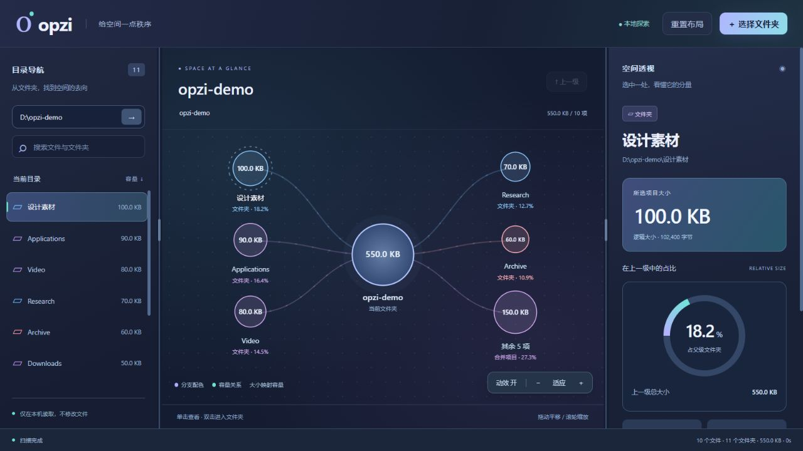

# opzi

**看见空间的脉络。** 一款 Windows 本地磁盘空间分析器，用目录、关系图和容量透视三栏联动，帮助你看清文件归属和空间占比。


> 早期版本，当前专注于只读扫描与可视化，不提供文件删除或自动清理功能。



*上图使用演示目录，路径已替换为示例路径，非真实个人磁盘内容。*

## 特性

- **三栏可调布局**：拖动分隔线调整目录、关系图和详情的宽度；支持双击重置与方向键微调。
- **文件关系图**：以节点和连线表达父子关系，大小映射容量，双击文件夹进入下一层。
- **动态反馈**：节点展开、轻微浮动、选中光圈与流动连线；支持关闭动画，遵循系统减少动态效果设置。
- **空间透视**：显示选中项大小、占父级比例、占扫描范围比例，以及最大的直接子项。
- **本地扫描**：支持隐藏项目、名称搜索、容量排序、取消扫描，以及权限错误提示。
- **快捷定位**：打开所在目录、复制路径、沿路径导航返回。

## 安装与启动

### Windows 软件包

若 [Releases](https://github.com/Ayanami-lppl/opzi/releases) 中提供 Windows 压缩包，下载后**完整解压**，双击 `opzi.exe`。`_internal` 文件夹需要与程序保持在一起。软件包无需另外安装 Python。

独立窗口需要 Microsoft Edge WebView2 Runtime；若系统未安装，请从 Microsoft 官方渠道安装。

### 从源码运行

```powershell
git clone https://github.com/Ayanami-lppl/opzi.git
cd opzi
python -m venv .venv
.venv\Scripts\python.exe -m pip install -r requirements.txt
.venv\Scripts\python.exe app.py
```

支持 Python 3.10+。桌面窗口使用 pywebview + Edge WebView2。Windows 是当前支持的平台，其他平台未测试。

浏览器模式和启动时预选目录：

```powershell
python app.py --browser
python app.py --root "D:\Example"
```

使用环境中已安装依赖的 Python 时，也可双击仓库内的启动脚本。浏览器模式需保持终端运行，按 `Ctrl+C` 退出。

## 使用

1. 点击右上角“选择文件夹”，或在左上角输入完整路径并按 Enter。
2. 单击目录或图形节点，在右侧查看大小和占比。
3. 双击文件夹节点进入，使用顶部路径或“上一级”返回。
4. 拖动图的空白处平移，滚轮缩放，“适应”恢复视图。
5. 拖动两条分隔线改变三栏比例；双击分隔线或点击“重置布局”恢复默认。
6. 右下角“动效”按钮可开关图形动画。

分隔线获得焦点后可使用左右方向键；按住 Shift 加速。布局与动效设置保存在当前浏览环境中，原生隔离窗口跨会话恢复不作保证。

## 数据口径与边界

- 仅读取文件系统元数据，不读取文件内容，不修改或删除文件；分析在本机完成。
- 应用服务只监听 `127.0.0.1`，API 使用每次启动生成的随机令牌。
- 显示的是**逻辑文件大小**，按 1024 换算单位；不代表磁盘实际分配空间。硬链接按路径分别累计。
- 符号链接和 Windows 目录联接会跳过，避免循环遍历。无法访问的项目会提示，可能导致统计不完整。
- 扫描中或取消后的结果为部分结果，文件并发变化也可能影响统计。
- 关系图根据可用高度展示若干最大的直接子项，其余合并。左侧显示最大的 500 项，搜索覆盖全部已扫描名称，最多返回 100 项。
- 当前使用内存索引，大型目录树的内存用量随文件数量增长。
- 运行日志可能含扫描路径；提交 Issue 前请先检查和脱敏。日志、缓存和扫描数据不应提交到仓库。

## 开发与打包

```powershell
python -m unittest discover -s tests -v
node --check ui/app.js
```

Node.js 只用于可选的 JavaScript 语法检查，运行软件不需要 Node.js。

在 Windows PowerShell 中激活虚拟环境后执行：

```powershell
.\.venv\Scripts\Activate.ps1
.\build.ps1
```

打包配置见 [build.ps1](build.ps1)。GitHub Actions 会进行扫描器测试；推送版本标签时构建 Windows 软件包并发布 Release。也可从 Actions 手动运行打包任务并下载构建产物。

## 后续方向

- 扫描快照与空间增长对比
- 实际磁盘分配空间统计
- 文件类型汇总与更丰富的筛选
- 多层关系图与大型目录的性能优化

## 参与与反馈

欢迎在 [Issues](https://github.com/Ayanami-lppl/opzi/issues) 反馈问题。请提供版本、Windows 版本、复现步骤，以及脱敏后的截图或日志。提交方式见 [CONTRIBUTING.md](CONTRIBUTING.md)。

## 许可证

[MIT](LICENSE)。第三方组件说明见 [THIRD_PARTY_NOTICES.md](THIRD_PARTY_NOTICES.md)。
